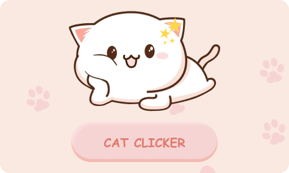
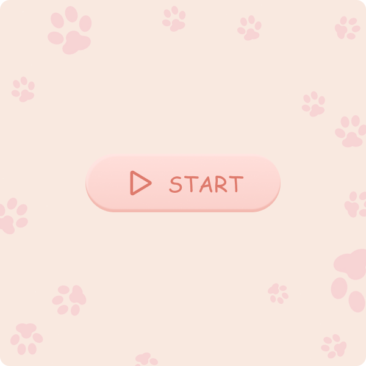
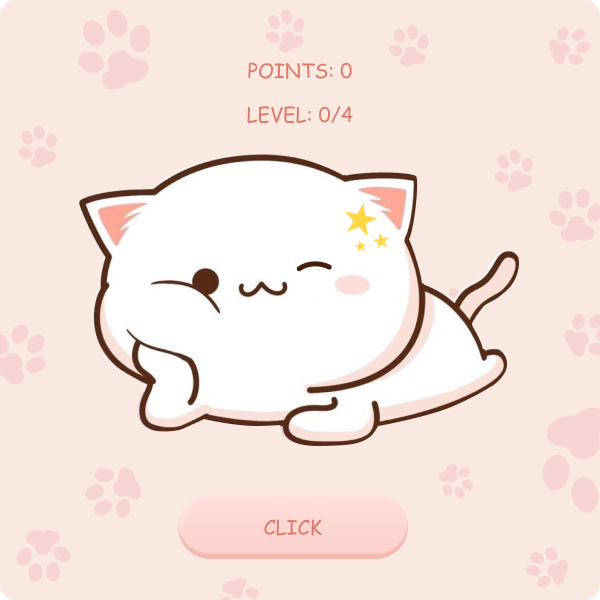
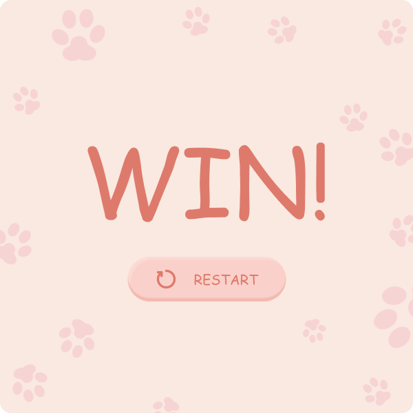

### Запуск игры
#### Запуск готового `.exe` файла (для игроков) 

1. Перейдите в раздел **Releases** (Релизы) справа на странице репозитория
2. Скачайте последний ZIP-архив
3. Распакуйте архив в любую удобную папку
4. Запустите файл **`Cat Clicker.exe`**

#### Запуск через исходный код `main.py` (для разработчиков)
*Требования:* Установленный Python 3.10+ и Git.

```bash
git clone https://github.com/krisstianeF/cat-clicker-game.git
```
```bash
cd cat-clicker-game
```
```bash
pip install -r requirements.txt
```
```bash
python main.py
```

# 🐱 Cat Clicker

Милая и уютная игра-кликер, в которой вам предстоит кликать, зарабатывать очки, повышать уровень и наблюдать, как ваш питомец становится счастливее! 

В игре есть три уровня сложности (состояния): стартовое окно, процесс игры и экран победы. Достигните 40 очков, чтобы выиграть!

| Стартовое окно | Главное окно (Игра) | Финальное окно (Победа) |
| :---: | :---: | :---: |
|  |  |  |

## 🛠 Технологии и структура

*   **Язык:** Python 3.12
*   **Интерфейс:** Tkinter (встроенная библиотека)
*   **Звуки:** Pygame (микшер)
*   **Сборка:** PyInstaller

### Структура проекта:
```text
cat-clicker-game/
│
├── main.py                # Главный исполняемый файл (исходный код)
├── requirements.txt       # Список библиотек для установки
├── README.md              # Этот файл с описанием
│
├── assets/                # Все ресурсы игры
│   ├── images/            # Картинки (фоны, котики, кнопки)
│   └── sounds/            # Звуковые эффекты и музыка
│
└── about/                 # Документация (дизайн, скриншоты, описание)
    └── Cat Clicker.md     # Подробный отчет о создании игры
```

## 🎨 Дизайн и создание

Вся графика для игры была нарисована в Figma. Подробный процесс создания, код и объяснение логики описаны в файле **[about/how_was_made.md](about/how_was_made.md)**.

Макеты в Figma: [Ссылка на проект](https://www.figma.com/design/XD7V6qreXn8q2WpRB7qBi4/Cat-Clicker)

---
*Сделано с любовью к котикам :3*
